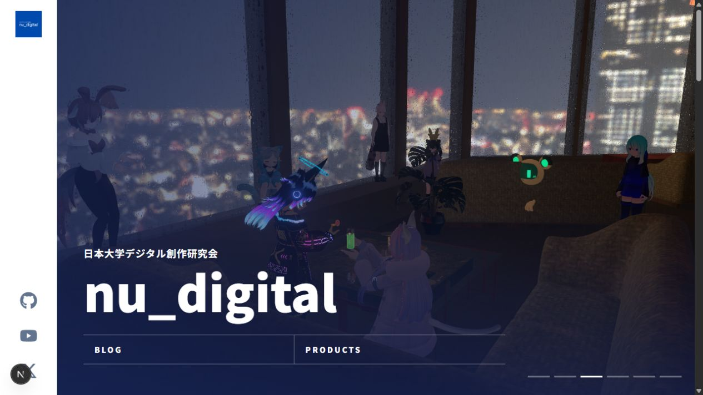
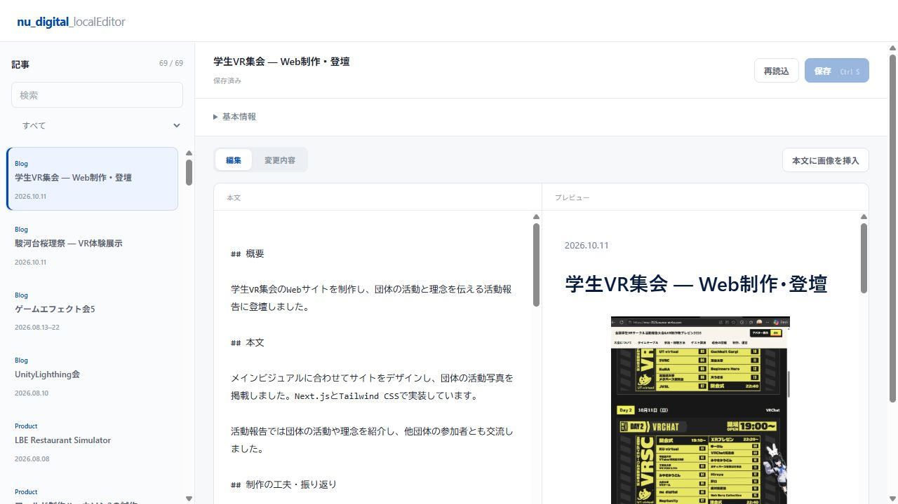
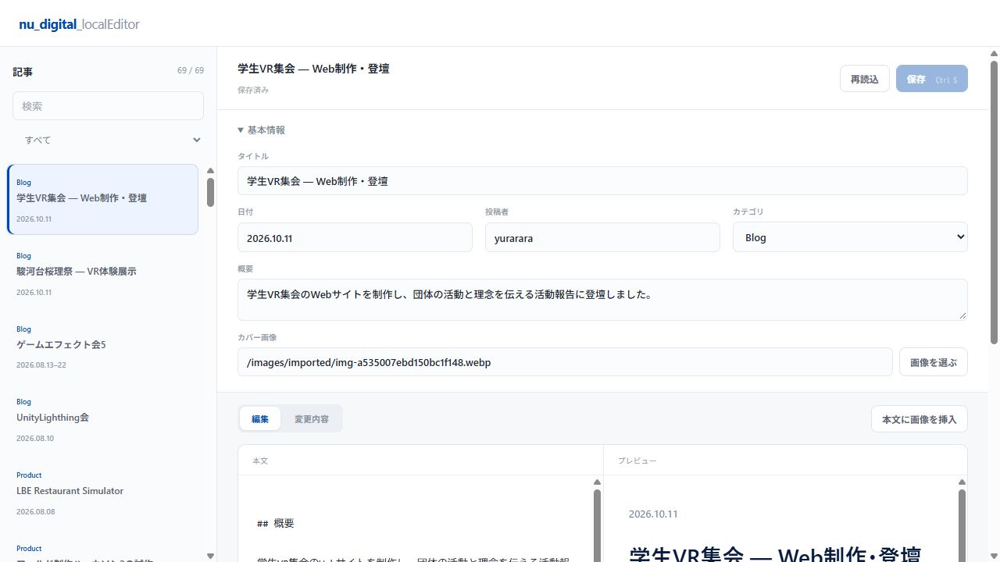

# nu_digital

ゲーム制作・VRChat・3D・Webなどの活動と作品を紹介する、nu_digital の公式ホームページです。団体カラーは **#004aad**。記事は Markdown で管理し、ブラウザーで編集できる **nu_digital_localEditor** を同梱しています。

[公開サイト](https://nu-digital.github.io/nu_digital/) · [記事の編集](#localeditor) · [記事メタデータ](#記事メタデータ)

## ホームページ



- **Home**：団体紹介、活動、注目の作品。
- **Blog**：活動報告・お知らせ・作品紹介を新しい順に表示。
- **Project**：制作した作品の一覧・詳細。
- **記事ページ**：写真を横並びに表示。クリックで拡大し、左右キーで移動、Escで閉じられます。

Next.js / React / TypeScript / Tailwind CSS を使用し、GitHub Pages に静的サイトとして公開します。

## はじめる

Node.js 22 と npm を用意し、プロジェクトのフォルダーで実行します。

```sh
npm ci
```

| やりたいこと | コマンド | 開く場所 |
| --- | --- | --- |
| ホームページの表示確認 | `npm run dev` | http://localhost:3000 |
| 記事の編集 | `npm run editor` | http://127.0.0.1:4310 |
| 公開用ファイルの生成 | `npm run build` | `out/` に出力 |

Windows PowerShell で npm の実行が制限される場合は `npm.cmd` を使ってください。サーバーの終了は `Ctrl+C` です。

## LocalEditor

**nu_digital_localEditor** は、既存の記事をブラウザーで編集するローカルツールです。



1. 左の一覧から記事を選ぶ。検索や **Blog / Product** の絞り込みもできます。
2. **基本情報**でタイトル・日付・カテゴリなど、**本文**で Markdown を編集する。
3. **プレビュー**で見た目、**変更内容**で保存前後の内容を確認する。
4. **保存**または `Ctrl+S`（Mac は `⌘S`）で保存する。

**画像を選ぶ**でカバー画像を設定し、**本文に画像を挿入**で既存画像を追加できます。新しい画像は `public/images/` に置き、エディターを再読み込みしてください。

保存先は `content/` の Markdown ファイルです。保存前の原文は `.content-editor/backups/` に自動で残ります。別のアプリなどで更新された記事は、競合を知らせて上書きを止めます。

> 保存だけでは公開されません。内容を確認して commit・push すると公開サイトに反映されます。プレビューは記事本文の確認用で、ページ全体や動画の動作はホームページ側で確認してください。

エディターはこのPCの `127.0.0.1` で動作し、公開サイトには含まれません。新規記事は次のテンプレートでファイルを作り、エディターを再読み込みすると編集できます。

## 記事メタデータ



記事は「先頭の基本情報（frontmatter）」と「Markdown本文」で構成します。

```md
---
title: "展示会に参加しました"
date: "2026-10-17"
category: "Blog"
author: "nu_digital"
image: "/images/events/exhibition.webp"
excerpt: "制作したゲームとVR作品を展示しました。"
---

## 展示の様子

ここに本文を書きます。


```

画像パスは例です。実際に配置したファイル名に置き換えてください。

| 項目 | 内容・入力例 |
| --- | --- |
| `title` | 記事タイトル。エディターでの保存時は必須。 |
| `date` | 日付はこの1項目だけ。`2026-10-17` → 表示は `2026.10.17`。月のみは `2026.10`、期間は `2026.08–09` や `2026.08.13–22`。不明なら `""`。 |
| `category` | `Blog`（活動報告・お知らせ）か `Product`（作品紹介）。 |
| `author` | 投稿者の表示名。 |
| `image` | カバー画像のパス。`public/images/` 内の画像は `/images/...` と記載。外部の `https://...` URLも使用可能。 |
| `excerpt` | 一覧カードや共有時の説明文。短い要約を記載。 |
| `sourceId` | 移行元を識別する任意の内部項目。新規記事には不要。既存の値はエディターで保持。 |

**保存フォルダーとカテゴリは別の役割です。** フォルダーとファイル名がURLを決め、`category` が表示・絞り込みに使われます。

| 記事の種類 | ファイル例 | サイト内のURL |
| --- | --- | --- |
| 活動報告 | `content/blog/exhibition.md` | `/blog/exhibition/` |
| お知らせ | `content/news/announcement.md` | `/news/announcement/` |
| 作品紹介 | `content/project/my-game.md` | `/project/my-game/` |

ファイル名は半角英数字とハイフンを推奨します。公開後の変更はURLも変わります。期間だけの記事は、その開始月・日を並び替えに使い、不明な日を表示に補いません。

## 写真の使い方

サイトの画像は `public/images/` に置き、記事から `/images/...` で参照します。画像だけの段落を続けると、画面幅に合わせて1〜3列のギャラリーになります。本文を挟むと別のグループになります。

写真セクション内の画像タイトル・キャプションは表示しません。`![画像の説明]` の説明は読み上げ用に残してください。画像は WebP、長辺2,560px以内を基本にします。変換には `python scripts/optimize_images.py`（Pillowが必要）を使用できます。

## 公開と管理

`main` に push すると GitHub Actions が lint → ビルド → Pages 公開を実行します。Pull Request では lint とビルドのみ実行します。GitHub の **Settings → Pages → Source** は **GitHub Actions** に設定してください。

画像は記事・コードと**別コミット**にします。サイト画像は `public/images/`、このREADMEのスクリーンショットは `docs/screenshots/` に保管します。`out/`・`.next/`・元の移行資料・エディターのバックアップは Git 対象外です。

| 場所 | 管理する内容 |
| --- | --- |
| `content/` | 記事・作品の本文とメタデータ |
| `data/site.ts` | 団体情報、SNSリンク、トップのおすすめ作品 |
| `app/`・`components/` | ホームページの構成・見た目 |
| `tools/content-editor/` | LocalEditor の画面・保存処理 |
| `lib/content-presentation.mjs` | 日付・カテゴリ・ギャラリーの共通処理 |
| `.github/workflows/pages.yml` | GitHub Pages の自動公開 |

色の調整はホームページの `app/globals.css`、LocalEditor の `tools/content-editor/style.css` にある `--brand-blue` を使います。

### 動作確認

```sh
npm run lint
npm run test:editor
node --test scripts/content-presentation.test.mjs
npm run build
```

GitHub Pages と同じ `/nu_digital/` 配下でビルドする場合は、`NEXT_PUBLIC_BASE_PATH=/nu_digital` と `NEXT_PUBLIC_SITE_URL=https://nu-digital.github.io/nu_digital` を環境変数に設定します。静的出力のため `npm run start` は使わず、普段の確認には `npm run dev` を使います。
